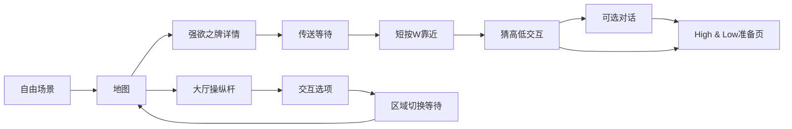

# hololive Dreams 结构与状态约定

最新稳定特征识别及启动共用规则见 [共享界面识别](robust-world-recognition.md)，覆盖本页此前关于启动未接入和仅特定对话证据的限制。

## 目录职责

```text
src/modular_agent/
  perception/                      通用截图、OCR、模板匹配
  computer/                        通用输入执行
  agent/interaction.py             通用转换循环、重试预算、加载等待和窗口检查
  agent/ui_actions.py              通用输入发送与目标边界检查
  agent/daily_tasks.py             旧导入路径兼容层，不保存游戏流程
  domains/hololive_dreams/
    daily_tasks.py                 日常模板、通知/派遣/礼物/轮盘状态流程
    interaction.py                 游戏场景策略及游戏状态到通用转换状态的映射
    states.py                      界面状态枚举、识别结果、纯识别函数
    templates.py                   入口模板分组和模板语义
    entry_observer.py              按阶段观察、OCR时间兜底
    entry_contract.py              各入口步骤的预期界面
    entry_flow.py                  入口执行流程、等待、重试和交接
    trace.py                       每次运行独立证据记录
  agent/entry_observer.py           旧导入路径兼容层

domains/hololive_dreams/
  models/
    fishing/                       钓鱼识别、控制、循环与配置
    greed_cards/                   强欲之牌入口桥接、玩法与结算
    jump_rope/                     历史跳绳路线与配置，experiments/为独立实验
    rhythm/                        音游引擎与配置
  daily_tasks_config.json          游戏层日常编排，可调用各小游戏
  launch.json                      游戏启动及本地技能启用配置
  knowledge/                       人类确认的世界知识
  data/                            原图、模板源、玩法资产
  vision_library/                   模板注册及匹配资产

runtime/greed-entry/<时间-唯一ID>/
  events.jsonl                     逐轮观察、决策、输入结果、异常及结束
  result.json                      本次结果
```

## 状态与流程分开

UIState描述当前帧看到什么：world.free、map.overview、map.location_detail、world.interaction、interaction.options、dialogue、overlay.reward、overlay.rank_up、transition.loading、overlay.error、minigame.greed.ready、minigame.greed.play、unknown。

Recognition包含state、evidence、map_name；未知保留unknown，不从上一动作反推“已成功”。证据优先级为错误/确认、奖励等覆盖层、地图与详情、小游戏、加载、对话和交互、最后自由HUD。只识别已支持证据，不声称覆盖所有游戏页面。

flow_step描述当前流程准备做什么，继续保留select_area、teleport、arrived等兼容值。expected_ui_states来自entry_contract，记录动作预期，不等于已到达。旧state结果字段暂保留，ui_state与flow_step用于新消费方。



决策树仍负责前置检查、动作、超时和交接；共享识别器不操作键鼠。运行期间不主动退出游戏。

## 日志

EntryObserver在真实adapter有root时创建独立运行目录，并输出路径；观察事件保存本次完整ScreenReport（包括模板坐标/分数、OCR文本、耗时、窗口信息）、OCR是否启用和Recognition。决策记录flow_step、ui_state、expected_ui_states及目标。输入事件保存实际动作参数和执行结果。所有报告来自当轮，不复用旧坐标。

日志目前不包含屏幕像素截图或视频；截图重放需后续扩展通用截图接口，不能称现有日志为完整视觉回放。result.json不再只依赖会覆盖的last-local-model-result.json。

## 迁移范围和扩展规则

本轮迁移强欲之牌入口及其观察器；StartupTree、DailyTasks和GreedCardsPlay尚未改用统一识别，不宣称全项目状态树已经统一。共享states.py可逐项扩充，接入其他模块时增加对应页面的正例和相似覆盖层反例，保持原命令兼容。

新增功能先补世界知识和样本，再加稳定状态证据、动作及预期、针对等待/错误/返回的回归测试。模板源来自归档截图，新图片不自动注册为可点击目标。

入口OCR仅在连续未知满5秒且距上次OCR满5秒触发；模板命中仍可能不泛化，需实机日志验证。地图配色判区及其他此前未实现功能不因重构而变成已支持。

验证：2026-10-17，共59项状态、入口、观察器、模块交接及窗口启动相关测试通过。未在真实游戏自动执行。
